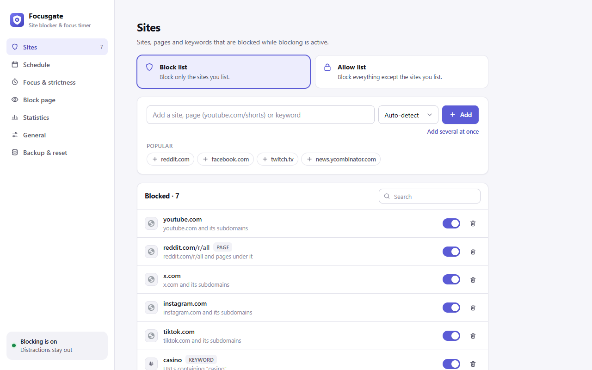
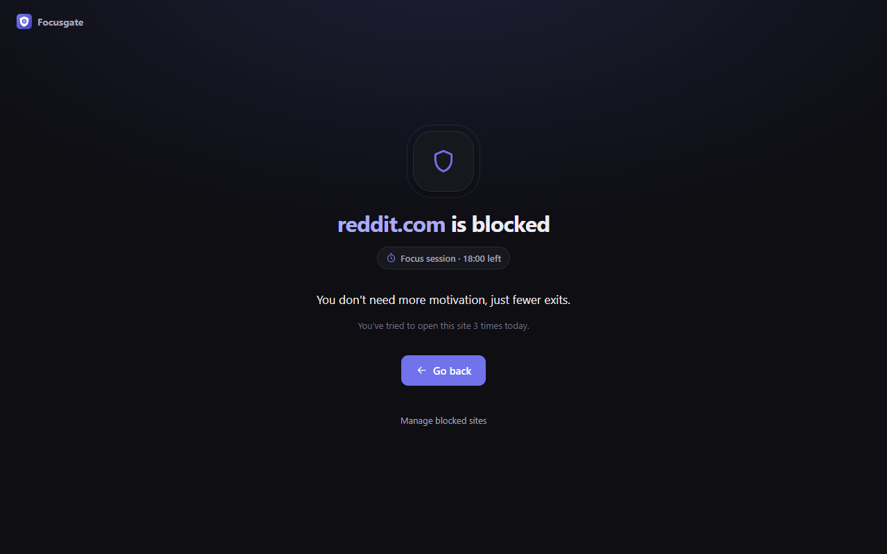
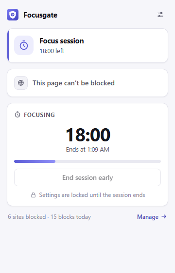
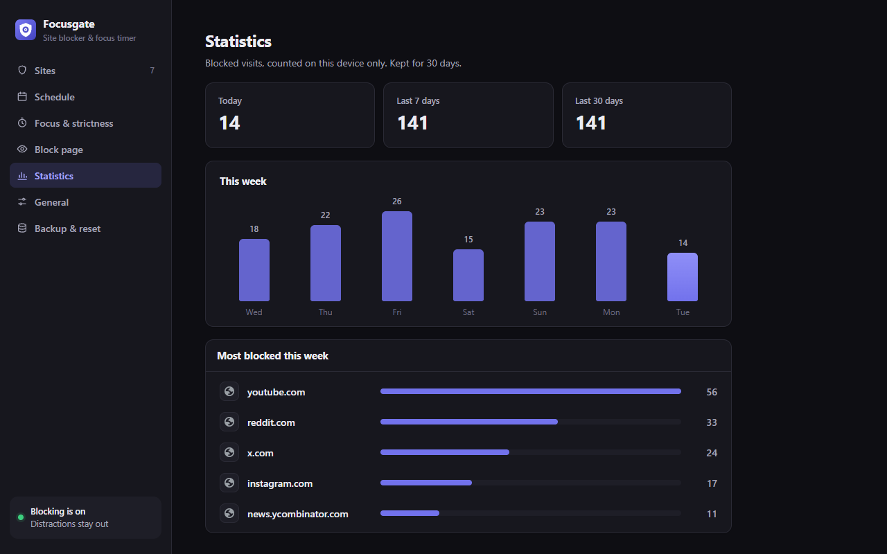

# Focusgate: site blocker and focus timer

A Chrome extension that keeps distracting sites out of the way. You can block whole sites, parts of
sites or keywords, choose the hours when blocking applies, and run focus sessions that can't be
skipped. Everything stays on your device.



| Block page | Popup | Statistics |
| --- | --- | --- |
|  |  |  |

## Features

- **Flexible rules.** Block a whole site (`reddit.com` and its subdomains), one section of a site
  (`youtube.com/shorts`), or any URL that contains a keyword. You can switch each rule off without
  deleting it.
- **Allow-list mode.** Block everything except the sites you need for work.
- **Schedules.** Set when blocking applies, for example weekdays 9–5. Overnight windows such as
  22:00–02:00 also work.
- **Focus sessions.** Start a 25, 50 or 90 minute session (or any length you choose) from the
  toolbar. The badge counts down while it runs. Lock mode stops you from ending the session early,
  pausing, or removing sites until it's over.
- **Pause.** Take a 5 to 60 minute break. Blocking turns back on by itself.
- **Temporary access with friction.** The block page can let you in for a few minutes after a
  countdown. You set how long the wait and the access last.
- **A calm block page.** It shows why the site is blocked and how long is left, plus a short line
  of encouragement or your own message, and how many times you tried to visit today.
- **Statistics.** Blocked attempts per day and your most-blocked sites. They stay on your device
  for 30 days.
- **Quick blocking.** Use the toolbar popup, right-click a page or link, or press
  <kbd>Alt</kbd>+<kbd>Shift</kbd>+<kbd>B</kbd>.
- **Backup.** Export your setup to JSON and import it again, merging with or replacing what you
  have.
- **Light and dark themes,** keyboard accessible, no remote code or assets.

## Install (development)

1. `git clone` this repo.
2. Open `chrome://extensions` and turn on **Developer mode**.
3. Click **Load unpacked** and select the `src/` folder.

If you used v1, your old block list is imported automatically.

## Development

```bash
npm install
npx playwright install chromium   # once, for E2E tests, icons and screenshots
npm test                          # unit tests (Vitest)
npm run test:e2e                  # end-to-end tests in real Chromium with the extension loaded
npm run package                   # dist/focusgate-<version>.zip for the Chrome Web Store
```

There's no build step: `src/` is the extension itself, written as plain ES modules.
[CLAUDE.md](CLAUDE.md) covers the architecture and the design decisions behind it.

## Privacy

Focusgate has no accounts, no analytics and makes no network requests. See [PRIVACY.md](PRIVACY.md).
